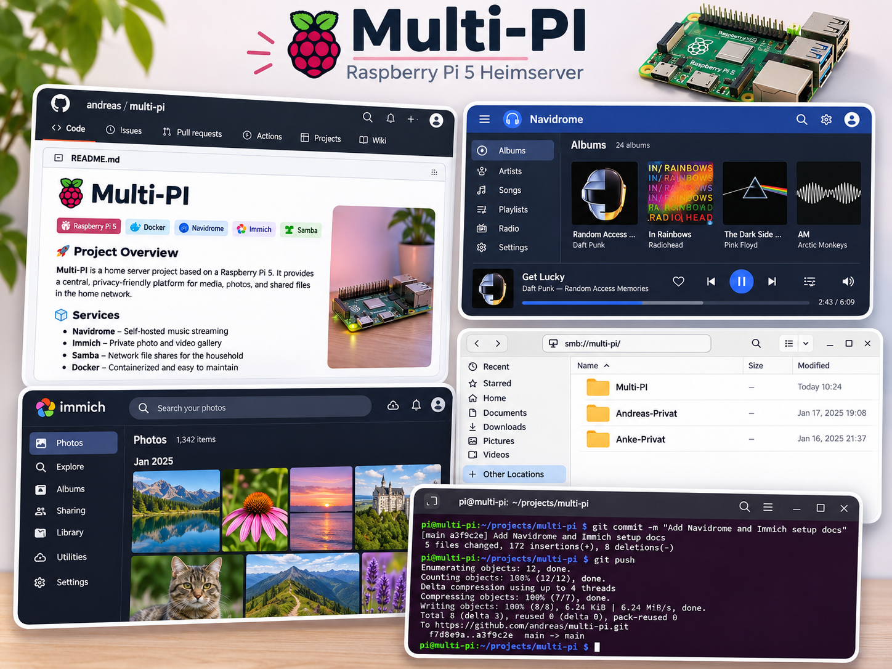
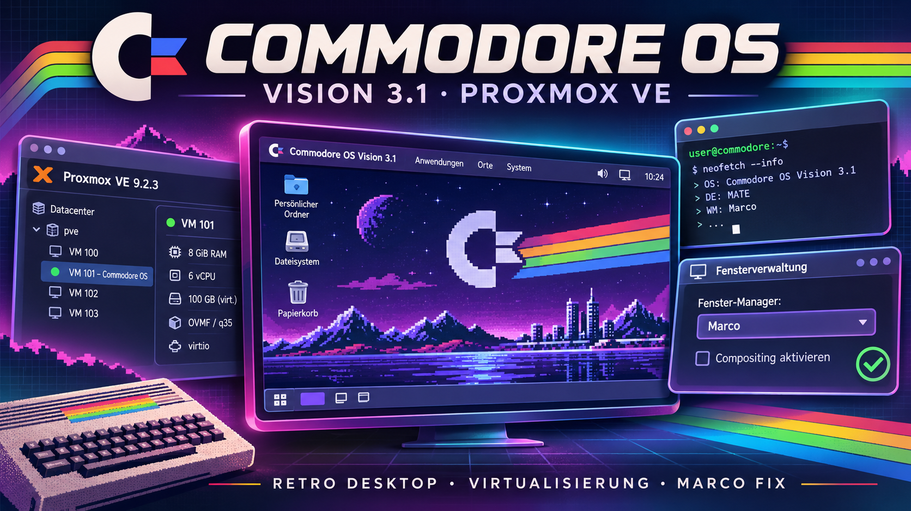

# Hallo, ich bin Andreas 👋

**Angehender IT-Systemelektroniker | Linux · Netzwerke · Python · Raspberry Pi**

Ich absolviere seit 2026 eine Umschulung zum IT-Systemelektroniker in Dresden. Nach meiner Tätigkeit im Elektrohandwerk beschäftige ich mich heute besonders gern mit IT-Infrastruktur, Netzwerktechnik, Linux und der Entwicklung praktischer Anwendungen für den Alltag.

## 🛠️ Technik, mit der ich arbeite:

  

  
  &nbsp;&nbsp;&nbsp;
  

  Proxmox VE · Commodore OS

- **Systeme und Netzwerke:** Debian, Raspberry Pi OS, Linux-Administration, DNS, DHCP, SSH, Samba

- **Entwicklung:** Python, FastAPI, Flask, SQLite, HTML, Git und GitHub

- **Betrieb und Virtualisierung:** Docker, Docker Compose, Caddy, systemd, Datensicherung und Proxmox VE

- **Hardware:** Raspberry Pi, Scanner, Drucker und kleinere Netzwerkprojekte

## 📦 Ausgewählte Projekte

### 🧺 Flohmarktverwaltung von Anke und Andreas

**Status:** 🟢 Im Betrieb – fortlaufende Weiterentwicklung

Browserbasierte Lager- und Verkaufsverwaltung für Flohmarkt und eBay auf einem Raspberry Pi 5.

**Funktionen:** Artikel- und Fotoerfassung, Regal- und Kistenverwaltung, Verkaufsarchiv, KI-unterstützte Artikelbeschreibungen und automatische Datensicherung.

**Technik:** Python, FastAPI, SQLite, Docker, Caddy, Debian 13

🔒 **GitHub:** Privates Repository

---

### 🚗 TLH-KFZ-Teile

**Status:** 🟡 Funktionsfähiger Projektstand – Erweiterungen geplant

Praxisprojekt zur digitalen Verwaltung gebrauchter Kfz-Ersatzteile mit eindeutiger Zuordnung zu Fahrzeugen und Lagerplätzen.

**Funktionen:** Fahrzeugverwaltung, Bestandsbuchungen, Barcodeerfassung, Etikettendruck, Benutzerrollen und automatische Datensicherung.

**Technik:** Python, Flask, SQLite, Linux, HTML, Barcode- und Drucktechnik

🔒 **GitHub:** Privates Repository

---

### 🏠 Multi-PI – Raspberry Pi 5 Heimserver

**Status:** 🟢 Im Betrieb – weiterer Ausbau

**Mein privater Heimserver auf Basis eines Raspberry Pi 5
mit 16 GB RAM und Debian 13.**

Der Multi-PI stellt Musik, Fotos, Videos und Dateien
zentral im Heimnetzwerk bereit.

**Bereits umgesetzt:**
- 🎵 Navidrome – Musikstreaming
- 📸 Immich – Foto- und Videoverwaltung
- 📂 Samba – Gemeinsame und private Netzwerkfreigaben
- 🐳 Docker – Verwaltung der Serveranwendungen
- 🔐 SSH – Fernadministration

**Geplante Erweiterungen:**
Sprachassistent, Musiksteuerung und weitere
Automatisierungen.

*Illustrative Projektcollage mit beispielhaften
Anwendungsoberflächen.*

🔒 **GitHub-Repository: Privat**

---

### 🖥️ Commodore OS unter Proxmox

**Status:** 🟢 Öffentlich dokumentiertes IT-Projekt

Installation und Konfiguration von Commodore OS Vision 3.1 in einer Proxmox-Virtualisierungsumgebung. Dokumentation der Einrichtung und der Behebung aufgetretener Desktop-Probleme.

**Schwerpunkte:** Virtualisierung, Betriebssysteminstallation, Linux, Systemkonfiguration und Fehleranalyse.

**Technik:** Proxmox VE, Commodore OS Vision 3.1, Linux, Virtuelle Maschinen

🌐 **GitHub:** [commodore-os-proxmox](https://github.com/andreasschauer18-netizen/commodore-os-proxmox)

---

## 🎯 Aktuell beschäftige ich mich mit:

## 📊 Meine GitHub-Aktivität

### Aktivitätsübersicht

*Die Grafik zeigt öffentlich zugängliche GitHub-Aktivitäten. Meine privaten Entwicklungsprojekte werden nicht vollständig berücksichtigt.*

### 💻 Programmiersprachen und Technologien

| Technologie | Einsatzbereich |
|---|---|
| 🐍 **Python** | Webanwendungen, Lagerverwaltung und Automatisierung |
| 🗃️ **SQL / SQLite** | Datenbanken, Artikel- und Bestandsverwaltung |
| 🌐 **HTML, CSS, JavaScript** | Browseroberflächen und Benutzerinteraktion |
| 🐧 **Bash / Shell** | Linux-Administration, Skripte und Datensicherung |

*Die Angaben beschreiben meine praktische Projekterfahrung und sind keine automatisch ermittelten GitHub-Sprachstatistiken.*

 
 **💻 GitHub:** [andreasschauer18-netizen](https://github.com/andreasschauer18-netizen)
